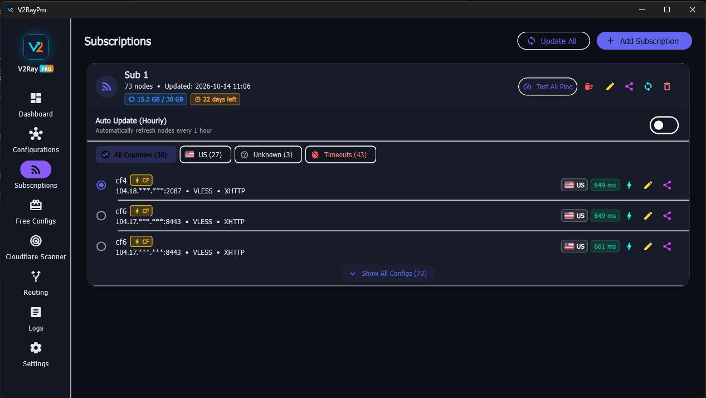

# V2RayPro Android

<p align="center">
  
</p>

<p align="center">
  <strong>Fast, Modern & Advanced V2Ray / Xray & Sing-box Client for Android</strong>
</p>

<p align="center">
  <a href="README.md">English</a> • <a href="README-fa.md">فارسی</a>
</p>

---

## 🚀 Key Features

- **Native Android VpnService**: High-throughput VPN mode powered by native tun2socks/hev-socks5-tunnel architecture.
- **Authentic Real Delay (تاخیر واقعی)**: Accurate end-to-end HTTP/WebSocket/gRPC protocol roundtrip ping (~600ms), matching v2rayN and v2rayNG without inflated TLS overhead.
- **Telegram-Style Navigation**: Sleek, modern bottom navigation bar with rounded pill indicators, badge counts, and smooth transitions.
- **Multi-Protocol Support**:
  - VLESS (Reality, TLS, WebSocket, gRPC, HTTPUpgrade, XHTTP)
  - VMess (WebSocket, TCP, mKCP, gRPC)
  - Trojan & Shadowsocks
  - Sing-box Outbound configurations
- **High-Speed CDN & Cloudflare Clean IP Scanner**:
  - Multi-threaded, asynchronous scanner with live latency probing.
  - Automatically activates for CDN-backed domains and hostnames.
  - Full support for newly added CIDR blocks (including `8.6.112.0/24`).
- **Smart Country Detection & Flags**:
  - Automatic country resolution with full support for Persian country names (آلمان، فرانسه، هلند، انگلیس، ترکیه، کانادا، آمریکا، etc.).
  - SNI and Host inspection for CDN-fronted nodes.
  - Offline local GeoIP database lookup.
- **Per-App Routing (Split Tunneling)**:
  - Route all apps through the proxy, or select specific apps to include/exclude.
- **Subscription Management & Free Daily Configs**:
  - One-click subscription update with automatic deduplication.
  - Real-time country filtering chips.

---

## 📱 Screenshots

<p align="center">
  
</p>

<p align="center">
  
  
</p>

<p align="center">
  
  
</p>

---

## 📥 Download APK

| Version | Architecture | Release File | Checksum |
| :---: | :---: | :---: | :---: |
| **v1.0.0** | Universal (`arm64-v8a`, `armeabi-v7a`, `x86_64`) | [Download APK](release/v2raypro-v1.0.0-android.apk) | [sha256sum.txt](release/sha256sum.txt) |

### Installation Instructions
1. Download `v2raypro-v1.0.0-android.apk` from the [release](release/v2raypro-v1.0.0-android.apk) directory.
2. Tap the downloaded APK file on your Android device (Android 7.0+).
3. Allow "Install from unknown sources" if prompted.
4. Launch **V2RayPro**, import your configs or subscriptions, and tap the connect button.

---

## 🛠️ Building from Source

### Prerequisites
- Flutter SDK (3.24.0 or higher)
- Android SDK (API 34+ / Build-Tools 36.0.0+)
- Java JDK 17 or higher (e.g. Android Studio JBR)

### Build Commands
```bash
# Clone the repository
git clone git@github.com:iamcloner/v2raypro-android.git
cd v2raypro-android

# Fetch dependencies
flutter pub get

# Run unit tests
flutter test

# Build release APK
flutter build apk --release
```

---

## 📄 License
This project is licensed under the GPL-3.0 License.
